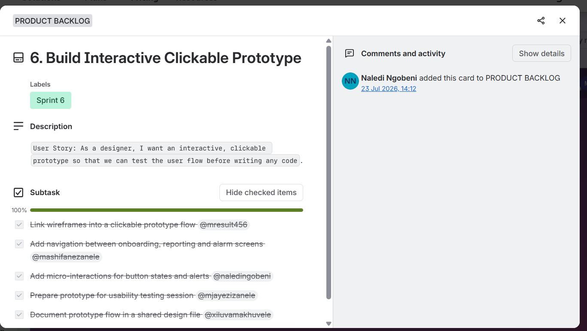

# Naledi Ngobeni 
### Third-Year ICT Application Development Student

 Cape Town, South Africa  
 230742912@mycput.ac.za  
 072 645 0657  
 GitHub: https://github.com/NalediNgobeni10  

---

##  Career Overview
Analytical and detail-oriented ICT Application Development student with strong foundations in software development, web technologies, and database integration. Experienced in collaborative academic projects, quality assurance, and team leadership. Passionate about building systems that solve real-world problems and continuously learning new technologies.

---

##  Career Objective
To obtain a Work Integrated Learning (WIL) placement where I can contribute to a professional team, strengthen my software development skills, and gain practical industry experience.

---

## Education

**Cape Peninsula University of Technology**  
Diploma in ICT: Application Development *(2024 – Present)*  

**Cape Peninsula University of Technology**  
Higher Certificate in Information Technology *(2023)*  

**Msengi Secondary School**  
National Senior Certificate *(2019)*  

---

##  Technical Skills
- Java  
- JDBC  
- HTML  
- CSS  
- GitHub  
- Database Integration  
- Testing and Quality Assurance  
- Teamwork and Collaboration  
- Leadership and Project Coordination  
- Time Management  
- Communication Skills  

---

##  Projects

###  Youth for a Change – NGO Website
**Role:** Quality Assurance Specialist  
**Technologies:** HTML, CSS, JavaScript  

Developed and tested an interactive website for a non-profit organisation supporting underprivileged children.

**Responsibilities:**
- Tested website functionality and usability  
- Ensured consistent design and performance  
- Collaborated with team members to improve the website  

---

###  CareLink – Virtual Counselling System
**Role:** Front-End Developer & Team Leader  
**Technologies:** Java, JDBC  

Built a virtual counselling system for CPUT students and staff.

**Responsibilities:**
- Developed login, registration, and booking features  
- Assisted with system design and implementation  
- Ensured privacy and secure access  
- Coordinated development tasks within the team  

---

##  Additional Experience
- Participated in group software development projects  
- Assisted with technical documentation and presentations  
- Worked in teams to meet deadlines  
- Demonstrated leadership and problem-solving skills  

---

##  Mock Interview Video

<video width="640" height="360" controls>
  <source src="mock-interview.mp4" type="video/mp4">
  Your browser does not support the video tag.
</video>

---

##  Reflection: Coding in Markdown

**Situation:** I was required to create a professional CV using Markdown for my GitHub portfolio.  
**Task:** I needed to structure my CV clearly while ensuring it remained readable and professional.  
**Action:** I used headings, bullet points, and formatting techniques in Markdown to organise my content effectively.  
**Result:** I was able to produce a clean and structured CV that is easy to read and suitable for an online portfolio.

---

##  Reflection: Mock Interview

**Situation:** I participated in a mock interview as part of my work readiness training.  
**Task:** I needed to present myself professionally and answer interview questions confidently.  
**Action:** I prepared by reviewing common interview questions and practicing my responses.  
**Result:** The experience improved my confidence, communication skills, and ability to present myself professionally. I also identified areas for improvement such as reducing nervousness and improving clarity.

---

##  Reflection: GitHub Pages

**Situation:** I was required to publish my portfolio using GitHub Pages.  
**Task:** I needed to convert my repository into a live website.  
**Action:** I configured GitHub Pages settings and ensured my Markdown file displayed correctly online.  
**Result:** I successfully created a live portfolio website, gaining practical experience in deploying web content and using version control tools.

---

##  References

**Mr Maremeni**  
Principal – Msengi Secondary School  
 078 800 9512  

**Prof Tembisa Ngqondi**  
Dean of Informatics – Cape Peninsula University of Technology  
 021 959 6911  

---

##  Thank You
Thank you for viewing my portfolio. I am eager to contribute my skills and continue growing as a software developer.

---
---

# SECOND SECTION: Agile Project Management Portfolio
### Project Presentation 3 (PRP370S) – SafeStreet Community Security Solution

About This Section

This is the second section of my digital portfolio, focusing on the Agile project management practices I applied during my Project-Based Work Integrated Learning (WIL) phase from July to August 2026. During this period, I worked as part of a team of five to develop SafeStreet, a proposed community security solution designed to address security concerns experienced by residents in Khayelitsha, Cape Town. The project focused on exploring how technology could help communities access security-related services more conveniently and improve communication around safety concerns.

Throughout the project, our team used Agile practices to organise our work, allocate responsibilities, monitor progress and respond to feedback. We used Trello to manage project tasks and track progress, GitHub to support our development workflow, and Microsoft Teams to communicate and present our work. These tools helped us coordinate our activities, share information and keep track of the different stages of the project.

My main responsibility was UI/UX Designer, with additional contributions to field interviews and the development of user personas. This role allowed me to participate in understanding the needs of our intended users and translating those needs into design ideas. My responsibilities included contributing to research, helping identify the needs of different user groups, developing wireframes and creating high-fidelity interface mockups. These activities helped me understand the importance of considering users' needs before making design decisions.

This portfolio section presents evidence of five key Agile components: the Agile Team Charter, User Stories and Tasks, Product Backlog, Sprint Backlog, and Agile Logbook. Each component demonstrates a different aspect of how our team organised and managed the project. The evidence includes relevant project records, Trello cards, screenshots and logbook entries, supported by reflections on my responsibilities, the challenges I experienced and the lessons I gained.

In addition to presenting the project evidence, this section reflects on my personal development throughout the WIL phase. It explains how I contributed to the team's work, how Agile practices helped me manage my responsibilities, and how feedback supported the improvement of our work. It also highlights areas where I believe our approach could be improved in future projects, particularly in planning, task allocation, communication and documenting progress.

Since 1 September 2026, I have been placed in an industry environment, where I have continued to recognise the value of practices such as tracking tasks, asking questions when clarification is needed, communicating challenges early and reflecting on completed work. This has helped me understand that Agile principles are not limited to academic projects; they can also support professional development and effective teamwork in the workplace.

Overall, this section demonstrates my understanding of Agile project management through the work completed during the SafeStreet project. It brings together the evidence of our team's working process and my individual reflections to show what I contributed, what I learnt and how I intend to apply these lessons in future academic and professional projects.

Proof of Industry Placement

My industry placement began in September 2026. As evidence, I have included my September 2026 Internship Report and attendance register, which was signed by my workplace supervisor. It records my induction in week 1, followed by system training, completion of training certificates and system familiarisation, and it includes my supervisor's comments on my performance and the signed attendance register for the month.

 [View my signed September 2026 Internship Report and Attendance Register (PDF)](https://naledingobeni10.github.io/NalediNgobeni10/Internship_Report_September_2026.pdf)

**Team Members:** Result Mhlongo, Zanele Faith Mashifane, Naledi Ngobeni, Xiluva Nivea Makhuvele and Zanele Mjayezi.

**My Role:** UI/UX Designer, with contributions to field interviews and user personas.

**Project Tools:** Trello, GitHub and Microsoft Teams.

**Contents:** [1. Agile Team Charter](#agile-charter) · [2. User Stories and Tasks](#user-stories) · [3. Product Backlog](#product-backlog) · [4. Sprint Backlog](#sprint-backlog) · [5. Agile Logbook](#agile-logbook)

## 1. Agile Team Charter

### Evidence
The following PDF presents the Agile Team Charter for the SafeStreet Community Security Solution, developed as part of our Project-Based Work Integrated Learning (WIL) from July to August 2026. The charter documents the team's purpose and vision, individual roles and responsibilities, Agile working practices, communication channels, decision-making approach, definition of done, core values, risks and constraints, and commitment to collaboration. It provides supporting evidence of how our team organised its activities and applied Agile principles while working towards a proposed community security solution for residents of Khayelitsha. The charter was compiled retrospectively for portfolio purposes using the available project information and records. Open the PDF below to review the complete Agile Team Charter.

 [Open the SafeStreet Agile Team Charter (PDF)](https://github.com/NalediNgobeni10/NalediNgobeni10/blob/main/SafeStreet_Agile_Team_Charter.pdf)

### Reflection on the Agile Team Charter

**Situation:** During the July–August 2026 SafeStreet project, our team of five had to collaborate to develop a proposed community security solution for Khayelitsha while balancing other academic responsibilities. This required us to coordinate our activities, understand our individual responsibilities and communicate effectively to make progress towards our shared project objectives.

**Task:** My responsibility as the UI/UX Designer, with additional contributions to field interviews and user personas, required me to understand the needs of our intended users and contribute to translating those needs into design ideas. At the same time, I needed to collaborate with my teammates and ensure that my design-related work supported the overall direction of the project.

**Action:** Throughout the project, we used Trello to organise and track tasks, GitHub to support our development workflow, and Microsoft Teams to communicate and present our work. These tools helped us coordinate activities and monitor progress. I contributed through user research, field interviews, user personas, wireframes and high-fidelity interface mockups. Reflecting on these experiences while compiling the Agile Team Charter helped me recognise the importance of clearly defined roles, shared expectations, regular progress updates and raising challenges before they delay the team's work. It also highlighted the value of reviewing work and using feedback to improve the quality of our deliverables.

**Result and learning:** This experience strengthened my understanding that successful teamwork involves more than completing individual tasks; it requires accountability, transparency, mutual respect and a shared understanding of what the team is trying to achieve. I also learnt that tools such as Trello are most effective when team members consistently update their tasks and communicate changes or blockers. One area I would improve in future projects is establishing and documenting the team charter at the beginning of the project, rather than compiling it retrospectively. This would allow every member to understand and confirm the agreed responsibilities, communication expectations and definition of done from the outset. I would also encourage more consistent documentation of decisions, progress and feedback throughout each sprint. Overall, the SafeStreet project helped me appreciate how Agile practices can improve collaboration, accountability and continuous improvement, and how these skills can be applied in both future software development projects and my professional workplace environment.

---

## 2. User Stories and Tasks

### Evidence
The following evidence presents the user stories and associated tasks created for the SafeStreet Community Security Solution. The Trello board was used to organise project requirements by describing features from the perspective of the intended users and breaking them down into smaller, manageable tasks assigned to team members. The user stories covered key activities, including assessing community security needs in Khayelitsha, analysing the local security landscape, defining target user personas, designing low-fidelity wireframes and high-fidelity UI mockups, and integrating a mobile payment gateway. The accompanying screenshots illustrate how individual cards documented user stories, assigned responsibilities and tracked task completion. Together, these records demonstrate how the team translated project objectives into actionable work items and monitored progress throughout the project.

🔗 [View the full SafeStreet Trello board](https://trello.com/b/urZ9fk2y/safestreet-community-security-solution)

| Card | User Story | My tasks (assigned to me) |
|---|---|---|
| 1. Conduct Community Needs Assessment in Khayelitsha | As a product team, we want to interview Khayelitsha residents and traders, so that we validate the real security problems before building the app. | Conduct field interviews with households, businesses and elderly residents |
| 2. Analyse Crime & Security Landscape in Khayelitsha | As a product team, we want to analyse local crime data and existing security measures so that we understand where SafeStreet can have the greatest impact. | Identify existing security measures (patrols, private security, police) |
| 3. Define Target User Personas | As a product team, we want documented user personas so that design and development decisions reflect real residents' needs. | Draft persona for community patrollers and guards |
| 4. Design Low-Fidelity Wireframes for Core App Screens | As a designer, I want low-fidelity wireframes of the core screens so that the team agrees on app structure before visual design begins. | Sketch wireframe for the incident reporting screen |
| 5. Design High-Fidelity UI Mockups | As a designer, I want high-fidelity mockups so that developers have a pixel-accurate design to build from. | Create high-fidelity mockup for the notifications screen |
| 44. Integrate Mobile Payment Gateway | As a resident, I want to pay securely from my phone so that subscribing to SafeStreet is quick and safe. | Create payment confirmations and receipts |

Each card's subtasks were shared across all five members, and every card shown reached 100% completion.

### Reflection
**Situation:** During the SafeStreet project, our team needed to understand the security challenges experienced by residents of Khayelitsha and translate those needs into practical requirements for a proposed community security solution. The project involved different types of work, including research, user experience design and software development, which required coordination between all five team members.

**Task:** My responsibility as the UI/UX Designer, alongside my contributions to field interviews and user personas, was to help ensure that our design decisions reflected the needs of the intended users. I also needed to contribute to breaking larger project objectives into tasks that could be understood, assigned and tracked.

**Action:** We used Trello to document user stories in the format "As a…, I want…, so that…" and divided them into smaller subtasks with assigned responsibilities. My contributions included field research involving households, businesses and elderly residents, identifying existing security measures, developing a persona for community patrollers and guards, and designing interface elements such as the notifications screen mockup. Organising this work through user stories helped me connect individual tasks to the wider purpose of the application rather than treating each task as an isolated activity.

One important insight I gained from working on SafeStreet was that designing a security application requires more than creating an attractive interface; the design must also make sense in situations where users may feel unsafe or need help quickly. For example, when considering the incident-reporting and notifications features, I recognised the importance of keeping information clear, making key actions easy to identify and avoiding unnecessary complexity. A resident trying to report a security concern should not have to navigate through confusing screens to understand what to do next. This helped me appreciate how user-centred design can influence both usability and the user's confidence in a digital solution. It also encouraged me to think beyond the visual appearance of a screen and consider the user's circumstances, accessibility needs and the practical purpose of each feature. In future projects, I would strengthen this approach by testing my wireframes and mockups with intended users and using their feedback to validate design decisions before development begins.

**Result and learning:** I learnt that effective user stories help a development team understand not only what a feature should do, but also why it matters to the intended user. Breaking work into subtasks made responsibilities clearer and allowed progress to be monitored through Trello checklists. This experience also strengthened my understanding of the relationship between user research, requirements and interface design. In future projects, I would improve the process by ensuring that each task has clear acceptance criteria, realistic due dates and measurable completion requirements. I would also make sure that user stories are reviewed regularly with the team so that misunderstandings can be identified early and changes can be made before they affect later work. Overall, this experience improved my ability to organise design work, collaborate with developers and maintain a user-centred approach to software development.

---

## 3. Product Backlog

### Evidence
The following evidence presents the SafeStreet product backlog maintained on Trello. The backlog contains 51 numbered cards representing the research, design and development activities required to progress the proposed community security solution. Items are organised in a logical sequence and labelled by sprint to help the team identify and track planned work. The cards include task checklists and progress indicators, making it easier to monitor completion and identify outstanding activities. The screenshots highlight selected backlog items, including community needs assessment, crime and security analysis, user persona development, wireframing and high-fidelity UI mockups. Together, this evidence demonstrates how Trello was used to organise project requirements, prioritise work and monitor progress throughout the SafeStreet project.

| # | Backlog Item | Sprint label | Progress |
|---|---|---|---|
| 1 | Conduct Community Needs Assessment in Khayelitsha | Sprint 1 | 5/5 done |
| 2 | Analyse Crime & Security Landscape in Khayelitsha | Sprint 2 | 5/5 done |
| 3 | Define Target User Personas | Sprint 3 | 5/5 done |
| 4 | Design Low-Fidelity Wireframes for Core App Screens | Sprint 4 | 100% done |
| 5 | Design High-Fidelity UI Mockups | Sprint 5 | 100% done |
| 44 | Integrate Mobile Payment Gateway | [see note: label currently reads "sprint 44"] | 100% done |

*(The board continues up to item 51. I added cards 5 and 44 myself on 23 July 2026.)*

### Reflection
**Situation:** During the SafeStreet project, our team needed to organise a range of research, design and development activities within a limited period.

**Task:** We needed a product backlog that clearly identified the work required and helped the team understand which activities needed attention as the project progressed.

**Action:** We used Trello to maintain the product backlog, organise tasks into sprint-labelled cards and monitor progress using checklists. I contributed to the backlog by adding the high-fidelity UI mockups item on 23 July 2026, which supported the transition from initial wireframes to more detailed interface designs. The backlog also helped us accommodate evolving project requirements and feedback, including improvements to the interface and further work on the system architecture and business model.

**Result and learning:** I learnt that a product backlog is not simply a list of tasks; it is a planning tool that helps a team organise its priorities and adapt when requirements change. I also gained a better understanding of how design activities contribute to the wider product development process. In future projects, I would improve the backlog by ensuring that every item has clear acceptance criteria, realistic deadlines and consistent sprint labels. This would make priorities easier to understand, progress easier to evaluate and collaboration more effective.

---

## 4. Sprint Backlog

### Evidence

The following evidence presents the SafeStreet sprint backlog, which was managed on the same Trello board as the product backlog. While the product backlog is the complete, ordered list of all 51 items the project might need, the sprint backlog is the smaller selection of those items that the team committed to completing during a particular sprint. We created our sprint backlog by giving each product backlog card a sprint label (Sprint 1, Sprint 2, Sprint 3 and so on), so that all cards carrying the same label formed the work for that sprint. Each of those cards was then broken into subtasks, and every subtask was assigned to a named team member and ticked off when completed. The screenshots and table below show how the first six sprints were planned, who was responsible for each part of the work, and that the planned work was completed.

| | Product Backlog | Sprint Backlog |
|---|---|---|
| **What it is** | The full, ordered list of everything the product needs (51 cards) | The selected items the team commits to in one sprint |
| **Scope** | The whole project | One sprint at a time |
| **Detail** | User stories and checklists for each item | Sprint labels, subtasks and the named owner of each subtask |
| **Purpose** | Plan and prioritise what must be built | Decide who does what now, and track it to completion |

The Trello cards for Sprints 1 to 4 are shown in full in [Section 2: User Stories and Tasks](#user-stories), where each card's user story, subtasks and assigned team members can be seen. The table below brings them together by sprint.

| Sprint | Backlog item | Subtasks and owners (examples) | Status |
|---|---|---|---|
| Sprint 1 | Conduct Community Needs Assessment in Khayelitsha | Recruit and schedule interview participants (Zanele F. Mashifane); conduct field interviews (Naledi Ngobeni) | Done (100%) |
| Sprint 2 | Analyse Crime & Security Landscape in Khayelitsha | Gather crime statistics (Result Mhlongo); map crime hotspots (Xiluva Makhuvele); identify existing security measures (Naledi Ngobeni) | Done (100%) |
| Sprint 3 | Define Target User Personas | Household persona (Result Mhlongo); small business and trader persona (Zanele F. Mashifane); elderly persona (Xiluva Makhuvele); patroller and guard persona (Naledi Ngobeni); validate personas (Zanele Mjayezi) | Done (100%) |
| Sprint 4 | Design Low-Fidelity Wireframes for Core App Screens | Onboarding and login screen (Result Mhlongo); incident reporting screen (Naledi Ngobeni) | Done (100%) |
| Sprint 5 | Design High-Fidelity UI Mockups | Home dashboard (Result Mhlongo); WhatsApp alert screen (Xiluva Makhuvele); guard and patrol profile screen (Zanele Mjayezi); notifications screen (Naledi Ngobeni) | Done (100%) |
| Sprint 6 | Build Interactive Clickable Prototype | Link wireframes into a clickable prototype flow (Result Mhlongo); add navigation between onboarding, reporting and alarm screens (Zanele F. Mashifane); add micro-interactions for button states and alerts (Naledi Ngobeni); prepare prototype for a usability testing session (Zanele Mjayezi); document the prototype flow in a shared design file (Xiluva Makhuvele) | Done (100%) |

### Reflection on the Sprint Backlog

**Situation:** The SafeStreet product backlog contained 51 items, but our team had a limited number of weeks and several other academic responsibilities. We could not work on everything at once, so we needed a way to decide what to do first and who would do it.

**Task:** I needed to understand which backlog items belonged to each sprint, complete the subtasks assigned to me, and make sure my work fitted into the sprint it belonged to.

**Action:** We used Trello sprint labels to select cards from the product backlog for each sprint, and every card's subtasks were assigned to a team member. My subtasks followed the stages of the project: conducting field interviews in Sprint 1, identifying existing security measures in Sprint 2, drafting the patroller and guard persona in Sprint 3, sketching the incident reporting wireframe in Sprint 4, creating the notifications screen mockup in Sprint 5, and adding micro-interactions for button states and alerts to the clickable prototype in Sprint 6. Ticking each subtask off in the Trello checklist showed when my part of a sprint was finished and let the team see its progress.

**Result and learning:** I learnt that a sprint backlog differs from a product backlog because it turns a long list of possible work into a short, achievable commitment with clear owners. Seeing my name beside specific subtasks made me more accountable, and the sequence of sprints showed how each stage built on the one before it: research first, then personas, then wireframes, detailed mockups and finally an interactive prototype. In future projects, I would improve our sprint planning by adding start and end dates and a clear sprint goal to each sprint, so that the team can judge whether a sprint was successful. I would also hold a short review at the end of each sprint to discuss what was completed, what was delayed and what should change in the next sprint.

---

## 5. Agile Logbook

### Evidence

The following evidence presents my Agile logbook, which I kept throughout the SafeStreet project in July and August 2026. The logbook records sixteen working days across four weeks: 14–17 July, 21–24 July, 28–31 July and 4–7 August. Each daily stand-up entry records what I completed since the last stand-up, what I planned to complete next, and the impediments or risks I faced. The entries from 14 to 24 July also include a short reflection on what I learnt that day. Together, the entries show how the project progressed from presenting our business idea, to refining and organising the Trello backlog and sprints, to designing and presenting prototypes, developing the application and preparing the business case and system architecture, and how lecturer feedback shaped each stage.

Open the logbooks below to review the full entries:

📄 [Logbook: 14–17 July 2026](logbooks/Agile_Logbook_14-17_July.pdf)

📄 [Logbook: 21–24 July 2026](logbooks/Agile_Logbook_21-24_July.pdf)

📄 [Logbook: 28–31 July 2026](logbooks/Agile_Logbook_28-31_July.pdf)

📄 [Logbook: 4–7 August 2026](logbooks/Agile_Logbook_4-7_August.pdf)

**Key moments recorded in the logbook**

| Date | What happened | What it taught us or changed |
|---|---|---|
| 14 Jul | Attended the business idea session; the team met and assigned presentation roles (presenter, slide designer and screen sharer) | Clear roles early make preparation more efficient |
| 15 Jul | Shared my screen while we presented our business idea to the lecturer on Microsoft Teams; feedback showed the idea needed refinement | Feedback is part of Agile because it shows weaknesses early |
| 16 Jul | Refined the business idea documentation and attended another group's presentation | Watching other teams gives ideas for improving our own work |
| 17 Jul | Team meeting on logbook requirements to make sure everyone completed their entries | Regular logging helps track progress and spot problems early |
| 21 Jul | Presented the product backlog on Trello; feedback said some tasks were too large | Agile tasks should be small enough to finish in one day |
| 22 Jul | Refined the backlog; feedback asked for user stories, colour labels and assigned tasks | The backlog needed major changes to follow Agile practice |
| 23 Jul | Added user stories, organised the backlog into sprint boards and created Sprint 1; the lecturer approved the improvements | Structure makes work easier to assign and track |
| 24 Jul | Presented the Trello boards and sprint planning, which the lecturer found satisfactory; started designing prototypes in Figma | Planning together helps the team meet milestones |
| 28 Jul | Presented the Figma prototype, which was approved as ready for development | Design approval allowed development to begin |
| 29 Jul | The lecturer was off sick, so I could not present progress or get feedback; backend development continued | Work must keep moving even when feedback is delayed |
| 31 Jul | Completed the backend and started the frontend | Each stage built on the one before it |
| 4 Aug | Presented the frontend prototype; feedback asked for better colours and a logo | Feedback improves how professional the product looks |
| 5 Aug | Presented the updated frontend, which was confirmed as satisfactory; the lecturer asked us to start the system architecture and business model | New requirements follow once earlier work is accepted |
| 6 Aug | Presented the business case, which was approved with feedback to keep refining it | Approval and improvement go together |
| 7 Aug | Refined the business case and checked that the architecture matched the application's requirements | Documents must match what we actually build |

### Reflection on the Agile Logbook

**Situation:** The lecturer required every team member to keep an Agile logbook during the SafeStreet project. The project moved quickly, with new feedback and new requirements arriving almost every week, and we were also balancing other modules.

**Task:** My responsibility was to record my progress, plans and problems accurately in each stand-up entry, and to use those records to reflect on how the project and the team were developing.

**Action:** I completed a logbook entry for each working day, answering what I had completed, what I planned to do next and what was getting in my way. The impediments I recorded show the real pressures of the project: finding a time when all team members could meet, internet connectivity problems, coordinating prototype work against a review deadline, the lecturer being unavailable on 29 July, and, most often, time management. Writing these down regularly helped me notice patterns. For example, I saw that time management appeared in many entries, which showed me that our workload needed better planning. The logbook also showed me how feedback shaped the project: the lecturer's comments led us to break large backlog tasks into one-day tasks, rewrite the backlog as user stories with colour labels and assigned owners, improve the colours and add a logo to the interface, and begin the system architecture and business model.

**Result and learning:** I learnt that an Agile logbook is more than a record of what happened; it is a tool for reflection and early problem-solving. Looking back through my entries, I can see how the team moved from a business idea, to an organised Trello backlog and sprints, to prototypes, a working application and a business case, and how each step followed from the feedback before it. It also showed me where I can improve. From 28 July onwards, my entries recorded only the three stand-up questions and left out the daily learning reflection that I included in earlier entries. In future projects, I would keep the reflection in every entry, because that is where much of the learning happens. I would also act on repeated impediments such as time management by raising them with the team and planning for them, instead of only recording them. Overall, the logbook has taught me to reflect regularly and honestly on my work, a habit that I now carry into my workplace.

---

## Overall Reflection: Bringing It All Together

**Situation:** Between July and August 2026, I worked as part of a team of five on SafeStreet, a proposed community security solution for residents and traders in Khayelitsha. The project had to be planned, designed and developed in a short period, alongside other academic responsibilities.

**Task:** My task was to apply Agile project management practices to organise and deliver my part of the work, and to demonstrate what I learnt through evidence and reflection. As the UI/UX Designer, with contributions to field interviews and user personas, I also needed to make sure the design work reflected the needs of the people SafeStreet was meant to help.

**Action:** The five components in this portfolio worked together as one system. The Agile Team Charter set out our purpose, roles and working agreements. User stories described each feature from the user's point of view and broke it into subtasks. The product backlog collected all 51 items in one ordered list, and the sprint backlog turned selected items into short, owned commitments. The Agile logbook recorded the day-to-day progress, the problems and the feedback that kept shaping our work. Through Trello, Microsoft Teams and regular lecturer feedback, I contributed field interviews, a persona, wireframes, high-fidelity mockups and prototype interactions.

**Result and learning:** This project taught me that Agile is a way of working built on small steps, regular communication, honest reflection and willingness to change. The most important lessons for me were that user stories keep a team focused on real people, that tasks should be small and clear, that feedback is a gift and not a criticism, and that documentation such as a team charter works best when it is created at the start, not afterwards. Since 1 September 2026, I have been working in an industry placement, where I see the same principles at work: tracking tasks, asking questions when something is unclear, communicating challenges early and reflecting on completed work. These are the habits I take with me into every future project.

---

## Closing Note

Agile taught me that good work is rarely done in one big leap. It grows from small, steady steps, honest conversations and a team that keeps learning together. Every card, sprint and logbook entry in this portfolio is a small part of that journey, and I am proud of what our team built for the people of Khayelitsha and of how much I grew along the way.

Thank you for taking the time to review my portfolio.

---
