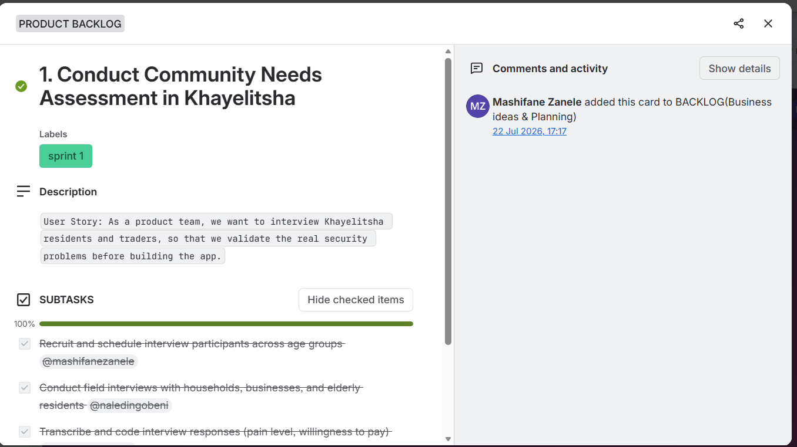
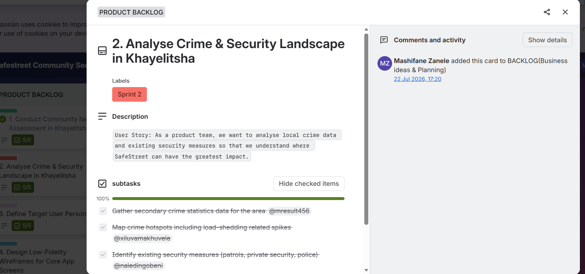
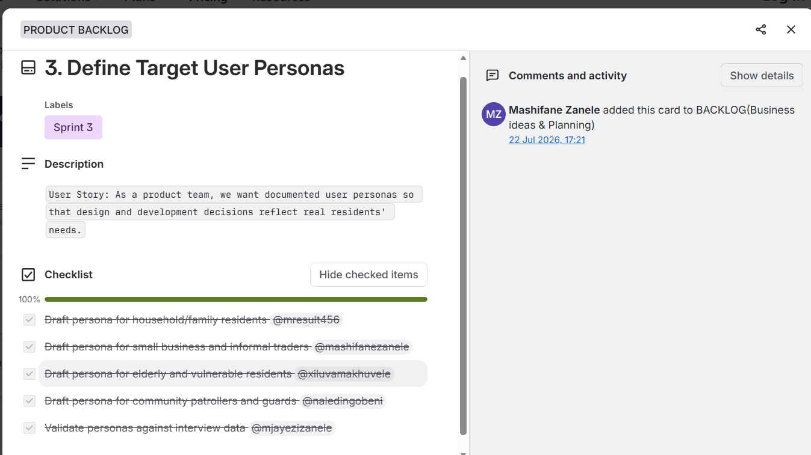
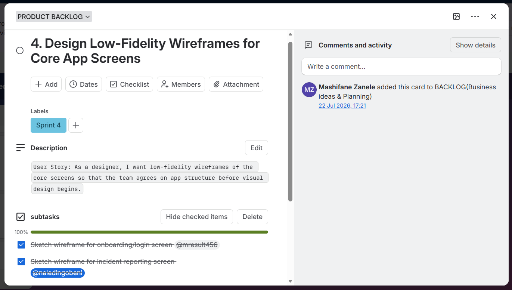
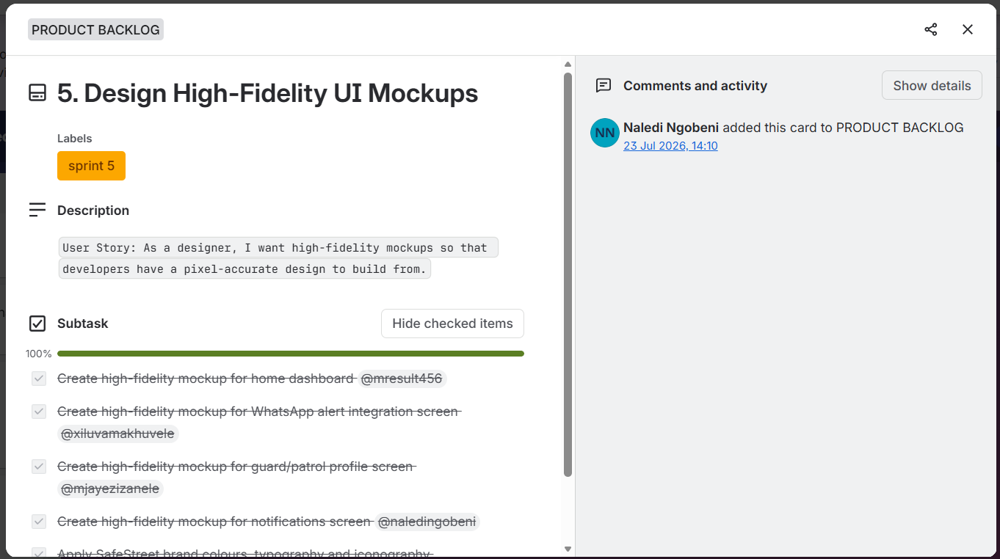
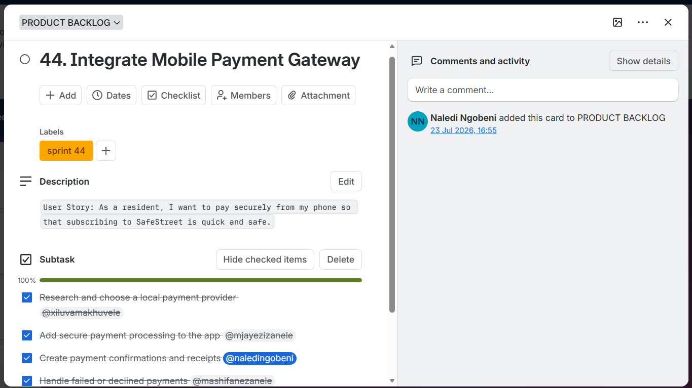
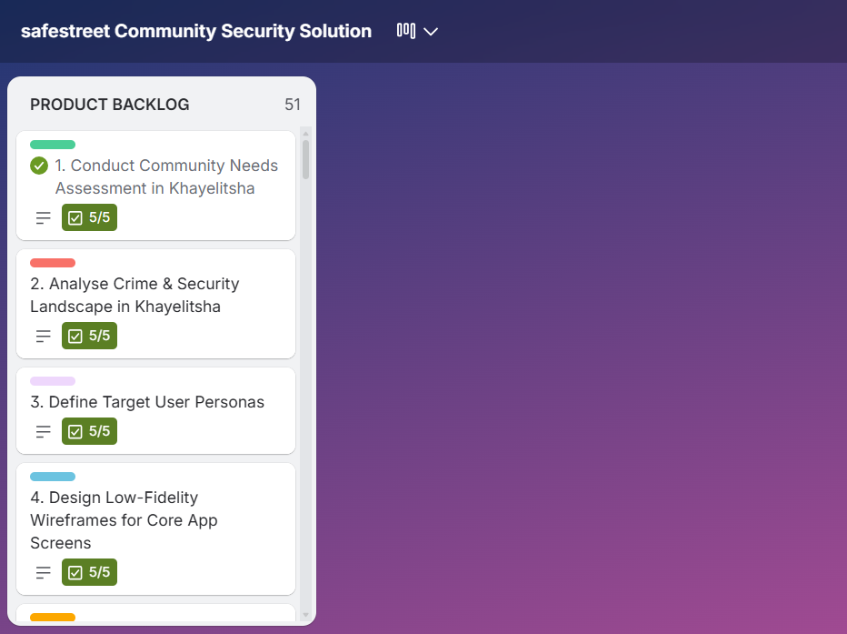
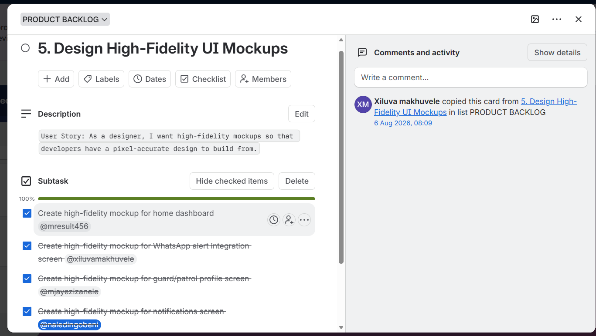

# Naledi Ngobeni 
### Third-Year ICT Application Development Student

 Cape Town, South Africa  
 230742912@mycput.ac.za  
 072 645 0657  
 GitHub: https://github.com/NalediNgobeni10  

---

##  Career Overview
Analytical and detail-oriented ICT Application Development student with strong foundations in software development, web technologies, and database integration. Experienced in collaborative academic projects, quality assurance, and team leadership. Passionate about building systems that solve real-world problems and continuously learning new technologies.

---

##  Career Objective
To obtain a Work Integrated Learning (WIL) placement where I can contribute to a professional team, strengthen my software development skills, and gain practical industry experience.

---

## Education

**Cape Peninsula University of Technology**  
Diploma in ICT: Application Development *(2024 – Present)*  

**Cape Peninsula University of Technology**  
Higher Certificate in Information Technology *(2023)*  

**Msengi Secondary School**  
National Senior Certificate *(2019)*  

---

##  Technical Skills
- Java  
- JDBC  
- HTML  
- CSS  
- GitHub  
- Database Integration  
- Testing and Quality Assurance  
- Teamwork and Collaboration  
- Leadership and Project Coordination  
- Time Management  
- Communication Skills  

---

##  Projects

###  Youth for a Change – NGO Website
**Role:** Quality Assurance Specialist  
**Technologies:** HTML, CSS, JavaScript  

Developed and tested an interactive website for a non-profit organisation supporting underprivileged children.

**Responsibilities:**
- Tested website functionality and usability  
- Ensured consistent design and performance  
- Collaborated with team members to improve the website  

---

###  CareLink – Virtual Counselling System
**Role:** Front-End Developer & Team Leader  
**Technologies:** Java, JDBC  

Built a virtual counselling system for CPUT students and staff.

**Responsibilities:**
- Developed login, registration, and booking features  
- Assisted with system design and implementation  
- Ensured privacy and secure access  
- Coordinated development tasks within the team  

---

##  Additional Experience
- Participated in group software development projects  
- Assisted with technical documentation and presentations  
- Worked in teams to meet deadlines  
- Demonstrated leadership and problem-solving skills  

---

##  Mock Interview Video

<video width="640" height="360" controls>
  <source src="mock-interview.mp4" type="video/mp4">
  Your browser does not support the video tag.
</video>

---

##  Reflection: Coding in Markdown

**Situation:** I was required to create a professional CV using Markdown for my GitHub portfolio.  
**Task:** I needed to structure my CV clearly while ensuring it remained readable and professional.  
**Action:** I used headings, bullet points, and formatting techniques in Markdown to organise my content effectively.  
**Result:** I was able to produce a clean and structured CV that is easy to read and suitable for an online portfolio.

---

##  Reflection: Mock Interview

**Situation:** I participated in a mock interview as part of my work readiness training.  
**Task:** I needed to present myself professionally and answer interview questions confidently.  
**Action:** I prepared by reviewing common interview questions and practicing my responses.  
**Result:** The experience improved my confidence, communication skills, and ability to present myself professionally. I also identified areas for improvement such as reducing nervousness and improving clarity.

---

##  Reflection: GitHub Pages

**Situation:** I was required to publish my portfolio using GitHub Pages.  
**Task:** I needed to convert my repository into a live website.  
**Action:** I configured GitHub Pages settings and ensured my Markdown file displayed correctly online.  
**Result:** I successfully created a live portfolio website, gaining practical experience in deploying web content and using version control tools.

---

##  References

**Mr Maremeni**  
Principal – Msengi Secondary School  
 078 800 9512  

**Prof Tembisa Ngqondi**  
Dean of Informatics – Cape Peninsula University of Technology  
 021 959 6911  

---

##  Thank You
Thank you for viewing my portfolio. I am eager to contribute my skills and continue growing as a software developer.

---
---

# SECOND SECTION: Agile Project Management Portfolio
### Project Presentation 3 (PRP370S) – SafeStreet Community Security Solution

About This Section

This is the second section of my digital portfolio, focusing on the Agile project management practices I applied during my Project-Based Work Integrated Learning (WIL) phase from July to August 2026. During this period, I worked as part of a team of five to develop SafeStreet, a proposed community security solution designed to address security concerns experienced by residents in Khayelitsha, Cape Town. The project focused on exploring how technology could help communities access security-related services more conveniently and improve communication around safety concerns.

Throughout the project, our team used Agile practices to organise our work, allocate responsibilities, monitor progress and respond to feedback. We used Trello to manage project tasks and track progress, GitHub to support our development workflow, and Microsoft Teams to communicate and present our work. These tools helped us coordinate our activities, share information and keep track of the different stages of the project.

My main responsibility was UI/UX Designer, with additional contributions to field interviews and the development of user personas. This role allowed me to participate in understanding the needs of our intended users and translating those needs into design ideas. My responsibilities included contributing to research, helping identify the needs of different user groups, developing wireframes and creating high-fidelity interface mockups. These activities helped me understand the importance of considering users' needs before making design decisions.

This portfolio section presents evidence of five key Agile components: the Agile Team Charter, User Stories and Tasks, Product Backlog, Sprint Backlog, and Agile Logbook. Each component demonstrates a different aspect of how our team organised and managed the project. The evidence includes relevant project records, Trello cards, screenshots and logbook entries, supported by reflections on my responsibilities, the challenges I experienced and the lessons I gained.

In addition to presenting the project evidence, this section reflects on my personal development throughout the WIL phase. It explains how I contributed to the team's work, how Agile practices helped me manage my responsibilities, and how feedback supported the improvement of our work. It also highlights areas where I believe our approach could be improved in future projects, particularly in planning, task allocation, communication and documenting progress.

Since 1 September 2026, I have been placed in an industry environment, where I have continued to recognise the value of practices such as tracking tasks, asking questions when clarification is needed, communicating challenges early and reflecting on completed work. This has helped me understand that Agile principles are not limited to academic projects; they can also support professional development and effective teamwork in the workplace.

Overall, this section demonstrates my understanding of Agile project management through the work completed during the SafeStreet project. It brings together the evidence of our team's working process and my individual reflections to show what I contributed, what I learnt and how I intend to apply these lessons in future academic and professional projects.

Proof of Industry Placement

My industry placement began in September 2026. As evidence, I have included my September 2026 Internship Report and attendance register, which was signed by my workplace supervisor. It records my induction in week 1, followed by system training, completion of training certificates and system familiarisation, and it includes my supervisor's comments on my performance and the signed attendance register for the month.

 [View my signed September 2026 Internship Report and Attendance Register (PDF)](https://naledingobeni10.github.io/NalediNgobeni10/Internship_Report_September_2026.pdf)

**Team Members:** Result Mhlongo, Zanele Faith Mashifane, Naledi Ngobeni, Xiluva Nivea Makhuvele and Zanele Mjayezi.

**My Role:** UI/UX Designer, with contributions to field interviews and user personas.

**Project Tools:** Trello, GitHub and Microsoft Teams.

Contents: 1. Agile Team Charter · 2. User Stories and Tasks · 3. Product Backlog · 4. Sprint Backlog · 5. Agile Logbook
---

## 1. Agile Team Charter

### Evidence
The following PDF presents the Agile Team Charter for the SafeStreet Community Security Solution, developed as part of our Project-Based Work Integrated Learning (WIL) from July to August 2026. The charter documents the team's purpose and vision, individual roles and responsibilities, Agile working practices, communication channels, decision-making approach, definition of done, core values, risks and constraints, and commitment to collaboration. It provides supporting evidence of how our team organised its activities and applied Agile principles while working towards a proposed community security solution for residents of Khayelitsha. The charter was compiled retrospectively for portfolio purposes using the available project information and records. Open the PDF below to review the complete Agile Team Charter.

 [Open the SafeStreet Agile Team Charter (PDF)](https://github.com/NalediNgobeni10/NalediNgobeni10/blob/main/SafeStreet_Agile_Team_Charter.pdf)

### Reflection on the Agile Team Charter

**Situation:** During the July–August 2026 SafeStreet project, our team of five had to collaborate to develop a proposed community security solution for Khayelitsha while balancing other academic responsibilities. This required us to coordinate our activities, understand our individual responsibilities and communicate effectively to make progress towards our shared project objectives.

**Task:** My responsibility as the UI/UX Designer, with additional contributions to field interviews and user personas, required me to understand the needs of our intended users and contribute to translating those needs into design ideas. At the same time, I needed to collaborate with my teammates and ensure that my design-related work supported the overall direction of the project.

**Action:** Throughout the project, we used Trello to organise and track tasks, GitHub to support our development workflow, and Microsoft Teams to communicate and present our work. These tools helped us coordinate activities and monitor progress. I contributed through user research, field interviews, user personas, wireframes and high-fidelity interface mockups. Reflecting on these experiences while compiling the Agile Team Charter helped me recognise the importance of clearly defined roles, shared expectations, regular progress updates and raising challenges before they delay the team's work. It also highlighted the value of reviewing work and using feedback to improve the quality of our deliverables.

**Result and learning:** This experience strengthened my understanding that successful teamwork involves more than completing individual tasks; it requires accountability, transparency, mutual respect and a shared understanding of what the team is trying to achieve. I also learnt that tools such as Trello are most effective when team members consistently update their tasks and communicate changes or blockers. One area I would improve in future projects is establishing and documenting the team charter at the beginning of the project, rather than compiling it retrospectively. This would allow every member to understand and confirm the agreed responsibilities, communication expectations and definition of done from the outset. I would also encourage more consistent documentation of decisions, progress and feedback throughout each sprint. Overall, the SafeStreet project helped me appreciate how Agile practices can improve collaboration, accountability and continuous improvement, and how these skills can be applied in both future software development projects and my professional workplace environment.

---

## 2. User Stories and Tasks

### Evidence
🔗 [View the full SafeStreet Trello board](https://trello.com/b/urZ9fk2y/safestreet-community-security-solution)
User stories describe a feature from the user's point of view. Each story was broken into tasks on our Trello board.

Every card on our Trello board contains a user story in its description, and the story is broken into subtasks. Each subtask is assigned to a team member and ticked off when done.

| Card | User Story | My tasks (assigned to me) |
|---|---|---|
| 1. Conduct Community Needs Assessment in Khayelitsha | As a product team, we want to interview Khayelitsha residents and traders, so that we validate the real security problems before building the app. | Conduct field interviews with households, businesses and elderly residents |
| 2. Analyse Crime & Security Landscape in Khayelitsha | As a product team, we want to analyse local crime data and existing security measures so that we understand where SafeStreet can have the greatest impact. | Identify existing security measures (patrols, private security, police) |
| 3. Define Target User Personas | As a product team, we want documented user personas so that design and development decisions reflect real residents' needs. | Draft persona for community patrollers and guards |
| 4. Design Low-Fidelity Wireframes for Core App Screens | As a designer, I want low-fidelity wireframes of the core screens so that the team agrees on app structure before visual design begins. | Sketch wireframe for the incident reporting screen |
| 5. Design High-Fidelity UI Mockups | As a designer, I want high-fidelity mockups so that developers have a pixel-accurate design to build from. | Create high-fidelity mockup for the notifications screen |
| 44. Integrate Mobile Payment Gateway | As a resident, I want to pay securely from my phone so that subscribing to SafeStreet is quick and safe. | Create payment confirmations and receipts |

Each card's subtasks were shared across all five members, and every card shown reached 100% completion.

### Reflection
**Situation:** SafeStreet needed research, design and development work, and no single person could do it all.
**Task:** We had to turn big goals into small pieces of work that each member could own.
**Action:** We wrote each backlog item as a user story ("As a..., I want..., so that...") and split it into subtasks with an assigned member. I took tasks such as field interviews with households, businesses and elderly residents, mapping existing security measures, the community patroller and guard persona, and the notifications screen mockup. [Add one detail about how you did one of these, e.g. how an interview went.]
**Result:** Writing stories from the user's point of view kept us focused on the real needs of Khayelitsha residents instead of just on features. Splitting stories into named subtasks made it clear who was responsible for what, and the checklist progress bars showed our progress at a glance. [Add one thing you would improve, e.g. smaller subtasks or due dates.]

---

## 3. Product Backlog

### Evidence
The product backlog is the prioritised list of everything the product needs.

Our Trello board, "SafeStreet Community Security Solution", holds a **Product Backlog list of 51 numbered cards**, ordered so that the earliest work comes first. Cards are colour-labelled by sprint and show a checklist progress badge (for example 5/5).

| # | Backlog Item | Sprint label | Progress |
|---|---|---|---|
| 1 | Conduct Community Needs Assessment in Khayelitsha | Sprint 1 | 5/5 done |
| 2 | Analyse Crime & Security Landscape in Khayelitsha | Sprint 2 | 5/5 done |
| 3 | Define Target User Personas | Sprint 3 | 5/5 done |
| 4 | Design Low-Fidelity Wireframes for Core App Screens | Sprint 4 | 100% done |
| 5 | Design High-Fidelity UI Mockups | Sprint 5 | 100% done |
| 44 | Integrate Mobile Payment Gateway | [see note: label currently reads "sprint 44"] | 100% done |

*(The board continues up to item 51. I added cards 5 and 44 myself on 23 July 2026.)*

### Reflection
**Situation:** Our lecturer's feedback and our own ideas kept changing what the project needed.
**Task:** We needed one ordered list of work so the team knew what mattered most.
**Action:** We built the backlog on Trello in July. The first cards were added on 22 July 2026 and I added card 5 (High-Fidelity UI Mockups) myself on 23 July. The backlog follows a logical order: research the community, analyse crime, define personas, wireframe, then design mockups. [Add what you did to add or reorder items.]
**Result:** The backlog let us respond to feedback. After the 4 August presentation we added colour improvements and a logo, and on 5 August the lecturer asked us to start on the system architecture and the business model. [Add your own insight.]

---

## 4. Sprint Backlog

### Evidence
The sprint backlog is the part of the product backlog the team commits to in one sprint.

We planned our sprints by tagging each product backlog card with a **sprint label** (Sprint 1, Sprint 2, Sprint 3 and so on). The cards with the same label made up that sprint's backlog.

| Sprint | Backlog item | Subtasks / owners (examples) | Status |
|---|---|---|---|
| Sprint 1 | Conduct Community Needs Assessment in Khayelitsha | Schedule interviews (Zanele M.); field interviews (Naledi) | Done (100%) |
| Sprint 2 | Analyse Crime & Security Landscape | Crime statistics (Result); crime hotspots (Xiluva); existing security measures (Naledi) | Done (100%) |
| Sprint 3 | Define Target User Personas | Household (Result); traders (Zanele F.); elderly (Xiluva); patrollers and guards (Naledi); validate (Zanele M.) | Done (100%) |
| Sprint 4 | Design Low-Fidelity Wireframes for Core App Screens | Onboarding/login screen (Result); incident reporting screen (Naledi) | Done (100%) |
| Sprint 5 | Design High-Fidelity UI Mockups | Home dashboard (Result); WhatsApp alerts (Xiluva); guard and patrol profile (Zanele M.); notifications screen (Naledi) | Done (100%) |

### Reflection
**Situation:** We had limited weeks and a long backlog of 51 items.
**Task:** We needed to choose the work we could realistically finish in each sprint.
**Action:** We used Trello labels to group backlog cards into sprints and assigned every subtask to a team member. In my sprints I handled field interviews, identifying existing security measures, the patroller and guard persona, and the notifications screen mockup. On 6 August a teammate copied the mockups card so we could keep working on it after the lecturer's feedback. [Add one detail about how you worked within a sprint.]
**Result:** Grouping work into sprints gave us short goals that we could finish and check off, and each sprint built on the one before it: research, then personas, then design. [Add what you would improve, e.g. adding sprint dates and goals on the board.]

---

## 5. Agile Logbook

### Evidence
I kept a daily logbook answering: What did I complete? What am I planning next? What are my impediments? What did I learn?

Download my logbooks: [14–17 July](logbooks/Agile_Logbook_14-17_July.pdf) · [21–24 July](logbooks/Agile_Logbook_21-24_July.pdf) · [28–31 July](logbooks/Agile_Logbook_28-31_July.pdf) · [4–7 August](logbooks/Agile_Logbook_4-7_August.pdf)

**Highlights:**
| Date | What happened | What I learnt |
|---|---|---|
| 14 Jul | Business idea session; team assigned presentation roles | Clear roles early make preparation more efficient |
| 15 Jul | Shared my screen while we presented our idea on Teams; feedback said the idea needed refining | Feedback shows where the idea must improve |
| 17 Jul | Updated the logbook; team meeting to make sure everyone completed entries | Regular logging helps track progress and spot problems early |
| 4 Aug | Presented the frontend prototype; the lecturer said it was satisfactory but asked for better colours and a logo | Listening to feedback improves the product |
| 5 Aug | Presented the updated frontend; the lecturer asked us to start the system architecture and business model | Work moves in stages, each building on the last |

### Reflection
**Situation:** The lecturer required each team member to keep a daily Agile logbook during the project.
**Task:** I had to record my progress, problems and learning honestly every day.
**Action:** I completed the four stand-up questions in each entry. I noted recurring challenges, mainly time management, balancing the project with other modules, finding times when everyone could meet, and some team members' internet problems. We also had trouble pushing our work to GitHub, which we solved together.
**Result:** The logbook made me think about my work instead of just doing it. It helped me spot risks early and improve communication. I still use the same stand-up questions in my industry placement.

---

## Overall Reflection: Connecting It All
**Situation:** Over July and August 2026 I worked in an Agile team to design SafeStreet.
**Task:** I needed to show that I understand Agile practices and can apply them.
**Action:** I used the team charter, user stories, product and sprint backlogs on Trello, and a daily logbook together. Each one supported the others.
**Result:** I learnt that Agile is about regular communication, feedback and small steps. Moving to my industry placement in September, I see the same ideas there. [Add one personal sentence on what you will do differently next time.]

---
